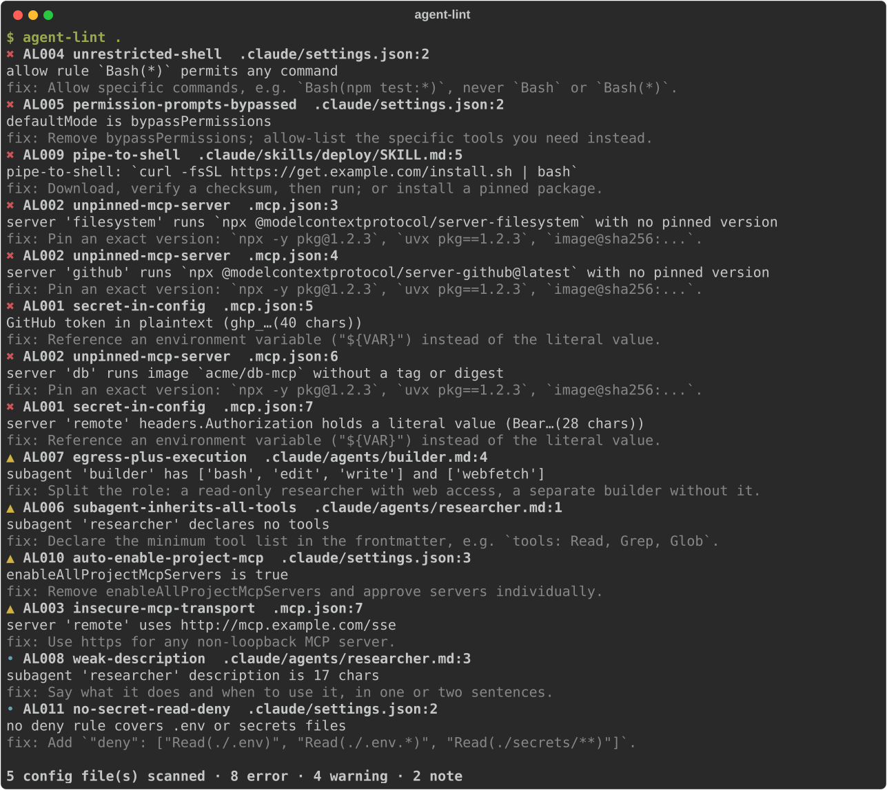

# agent-lint

**Least-privilege and supply-chain linter for Claude Code agents.** It scans your `.claude/` subagents, skills, `settings.json` and `.mcp.json` for the configurations that turn a helpful agent into an incident.

[](https://github.com/mjha-arya/agent-lint/actions/workflows/ci.yml)




## Why

Agent configs are now an attack surface. A coding agent reads untrusted content, so a few common shortcuts become real risks:

- `npx -y some-mcp-server` with **no version** means anyone who takes over that package runs code in your agent loop on the next start
- `"allow": ["Bash(*)"]` or `bypassPermissions` means a prompt injection is one step from a shell
- a subagent with **no `tools:` line** inherits *everything*, so the agent you wrote as a reviewer can also write and run code
- a token pasted into `.mcp.json` ends up in git history

agent-lint finds these with plain code: **no model, no network, zero dependencies**, and it runs in about a second.

## Install and run

```bash
pip install git+https://github.com/mjha-arya/agent-lint
agent-lint .                      # human-readable
agent-lint . --format sarif -o agent-lint.sarif
agent-lint ~/.claude              # your user-level agents and skills too
```

Exit code is `1` when an error-level finding exists (`--fail-on warning|note|never` to change).

## In CI (GitHub code scanning)

```yaml
# .github/workflows/agent-lint.yml
on: [push, pull_request]
permissions: { contents: read, security-events: write }
jobs:
  agent-lint:
    runs-on: ubuntu-latest
    steps:
      - uses: actions/checkout@v4
      - uses: mjha-arya/agent-lint@v0.1.0
```

Findings show up inline on pull requests, as code-scanning alerts.

## Rules

| ID | Level | Rule | Catches |
|---|---|---|---|
| AL001 | error | `secret-in-config` | API keys, tokens and private keys in agent config, MCP `env` or `headers` (always redacted in output) |
| AL002 | error | `unpinned-mcp-server` | `npx`/`bunx`/`uvx`/`pipx` packages with no version or `@latest`; docker images with no tag or digest |
| AL003 | warning | `insecure-mcp-transport` | remote MCP servers over `http://` |
| AL004 | error | `unrestricted-shell` | `Bash`, `Bash(*)` or `PowerShell(*)` in `permissions.allow` |
| AL005 | error | `permission-prompts-bypassed` | `bypassPermissions` or `skipDangerousModePermissionPrompt` |
| AL006 | warning | `subagent-inherits-all-tools` | subagents with no `tools:` field |
| AL007 | warning | `egress-plus-execution` | one agent with shell/write **and** web access, the exfiltration shape |
| AL008 | note | `weak-description` | missing or too-short agent/skill descriptions (they route badly) |
| AL009 | error | `pipe-to-shell` | `curl … \| bash` in skills, agents, hooks or CLAUDE.md |
| AL010 | warning | `auto-enable-project-mcp` | `enableAllProjectMcpServers: true` |
| AL011 | note | `no-secret-read-deny` | permissions with no deny rule for `.env` or secrets |

`agent-lint --list-rules` prints the same table.

## What it scans

`.mcp.json` · `.claude/settings.json` · `.claude/settings.local.json` · `.claude/agents/*.md` · `**/SKILL.md` · `CLAUDE.md` / `AGENTS.md` · scripts under `hooks/`

**Not checked (yet):** plugin marketplaces, Cursor rules, hook command semantics beyond pipe-to-shell, or whether a pinned version is itself safe. agent-lint tells you *what is unpinned or over-privileged*, not whether a package is malicious.

## Design

- **Deterministic.** Regex and AST over files, no LLM. The same input always gives the same report.
- **Secrets never echo.** Matches are shown as `ghp_…(40 chars)`.
- **Honest output.** An empty scan says `NOT CHECKED` instead of passing silently.

## Roadmap

Cursor (`.cursor/mcp.json`, rules) · Codex/OpenCode configs · rule suppression comments · a `--fix` mode that pins versions from the registry.

Issues and PRs welcome, especially new rules with a fixture showing the risky config.

---
Built by **[Manish Jha](https://github.com/mjha-arya)**: 10 years in security operations, now building secure and provable AI agents. Part of the same body of work as the [Constitution of Agents](https://github.com/mjha-arya/constitution-of-agents) and [Shiva](https://github.com/mjha-arya/shiva).
